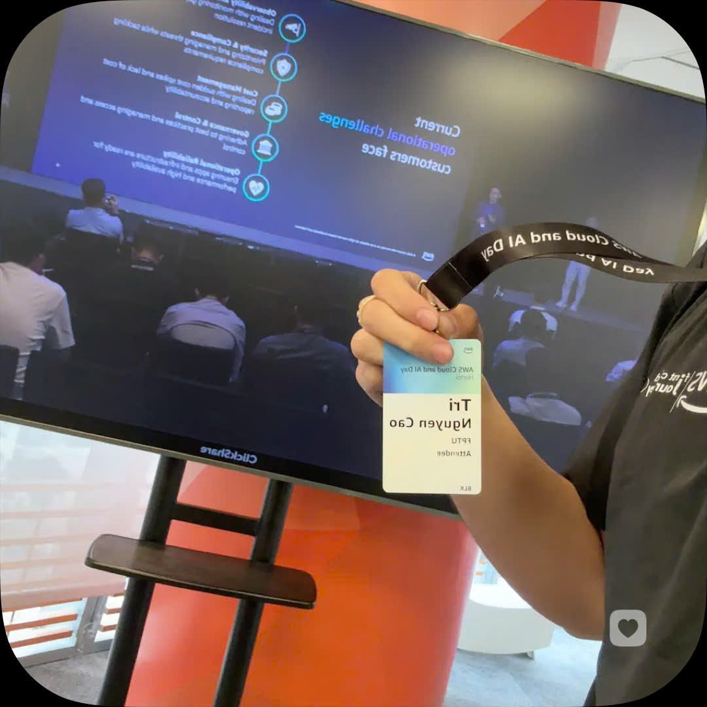

# AWS CLOUD & AI DAY 2026: BUỔI WATCH PARTY TẠI TP. HỒ CHÍ MINH

Khi sự kiện AWS Cloud & AI Day 2026 diễn ra tại Hà Nội, tôi không thể bay ra tham dự trực tiếp. Thay vào đó, tôi đã tham gia buổi Watch Party tại văn phòng AWS ở TP. Hồ Chí Minh, được tổ chức bởi cộng đồng AWS Study Group. Ban đầu, tôi chỉ dự định theo dõi livestream và hòa mình vào không khí của sự kiện. Tuy nhiên, hóa ra những cuộc trò chuyện thân mật trong giờ giải lao mới là phần mang lại nhiều giá trị nhất trong ngày hôm đó.

Căn phòng có sự tham gia của hơn 300 người hoạt động trong lĩnh vực công nghệ, tất cả đều dành trọn một ngày để tham gia sự kiện. Không khí rất thân thiện và sôi nổi. Mỗi khi màn hình chuyển sang phần giải lao, mọi người lập tức quay sang trao đổi và thảo luận về những nội dung vừa được chia sẻ.

## Những điều tôi ấn tượng nhất

### Ba điểm nổi bật từ phần Keynote

Tôi đặc biệt chú ý đến ba chủ đề chính: sự phát triển của **Agentic AI** (AI không chỉ dừng lại ở việc trả lời câu hỏi mà còn có khả năng tự thực hiện các quy trình gồm nhiều bước); tầm quan trọng của **nền tảng dữ liệu vững chắc** như một điều kiện tiên quyết để ứng dụng AI vào thực tế; và các chiến lược **hiện đại hóa hạ tầng Cloud** dành cho doanh nghiệp.

### Giá trị thực tế từ các buổi thảo luận nhóm

Điều bất ngờ là những kiến thức giá trị nhất không chỉ đến từ sân khấu chính. Trong các buổi thảo luận nhóm, các Solution Architects và lập trình viên đã thẳng thắn chia sẻ về những khó khăn khi đưa một AI Agent từ giai đoạn thử nghiệm (POC) vào môi trường production, cũng như những phương pháp tối ưu chi phí Cloud trong thực tế.

Việc được lắng nghe những người có kinh nghiệm chia sẻ các vấn đề họ từng gặp phải mang lại cho tôi nhiều góc nhìn thực tế hơn so với việc chỉ đọc tài liệu hoặc xem slide. Phần lớn thời gian, tôi tập trung lắng nghe và ghi chép lại những thông tin quan trọng.

## 4 bài học tôi muốn áp dụng vào công việc của mình

### 1. Một bản demo hoạt động tốt mới chỉ là điểm khởi đầu

Qua những chia sẻ về các dự án triển khai thực tế, tôi nhận ra khoảng cách rất lớn giữa một AI Agent chạy ổn định trên máy tính cá nhân và một hệ thống có thể vận hành đáng tin cậy trong môi trường production.

Đối với dự án AI Agent cá nhân, tôi dự định bổ sung những thành phần trước đây mình chưa thực sự chú trọng, bao gồm: logging để theo dõi các hành động của Agent, kiểm soát quyền truy cập theo nguyên tắc Least Privilege và thiết lập monitoring để phát hiện khi Agent hoạt động sai hoặc gặp sự cố.

### 2. Dữ liệu quyết định giới hạn khả năng của AI

Những chia sẻ về nền tảng dữ liệu khiến tôi nhìn nhận lại dự án hiện tại của mình. Dữ liệu đang được lưu trữ rời rạc và chưa có sự thống nhất trong cách đặt tên cũng như tổ chức.

Trong tuần này, tôi dự định tập hợp và chuẩn hóa lại toàn bộ dataset trước khi nghĩ đến việc nâng cấp mô hình hoặc tìm cách làm cho Agent trở nên thông minh hơn.

### 3. Chi phí là một yếu tố cần được tính toán ngay từ khâu thiết kế kiến trúc

Trước đây, tôi chủ yếu quan tâm đến việc làm sao để hệ thống hoạt động được. Tuy nhiên, qua các buổi thảo luận, tôi nhận ra những kỹ sư có kinh nghiệm luôn xem xét chi phí ngay từ khi thiết kế kiến trúc hệ thống, thay vì đợi đến cuối tháng mới bất ngờ trước hóa đơn dịch vụ.

Tôi sẽ hình thành thói quen ước tính chi phí cho mọi dự án, kể cả những dự án chỉ phục vụ mục đích học tập, sau đó so sánh với mức sử dụng thực tế sau 30 ngày.

### 4. Đừng ngần ngại bắt chuyện tại các sự kiện công nghệ

Tôi vốn khá ngại chủ động bắt chuyện với người lạ. Tuy nhiên, lần này tôi đã thử chủ động hỏi một vài người ngồi bên cạnh về công việc và những dự án họ đang thực hiện.

Những cuộc trò chuyện đó mang lại cho tôi nhiều góc nhìn thực tế hơn so với việc chỉ tự tìm hiểu tài liệu ở nhà. Mục tiêu của tôi trong những sự kiện tiếp theo khá đơn giản: làm quen với ít nhất hai người mới và chủ động giữ liên lạc với họ sau sự kiện.

## Tổng kết

Tôi rời khỏi sự kiện với cảm giác đã cập nhật được những xu hướng mới của ngành công nghệ. Tuy nhiên, bài học lớn nhất mà tôi nhận được lại liên quan đến cách chúng ta học hỏi: cùng xem một bài Keynote, nhưng việc theo dõi một mình và theo dõi trong một cộng đồng có sự tương tác sẽ mang lại hai trải nghiệm hoàn toàn khác nhau.

Việc đầu tiên tôi dự định thực hiện trong tuần này là đánh giá lại dự án AI Agent cá nhân dựa trên ba yếu tố chính: logging, data và cost.

Nếu bạn đang tự học công nghệ và cảm thấy bế tắc, hãy thử tìm kiếm và tham gia một cộng đồng công nghệ tại địa phương. Việc có những người cùng trao đổi và chia sẻ ý tưởng sẽ giúp bạn tiếp thu kiến thức nhanh hơn và ghi nhớ lâu hơn.

### Một số hình ảnh khi tham gia sự kiện

> Tổng thể, sự kiện không chỉ cung cấp kiến thức kỹ thuật mà còn giúp tôi thay đổi cách tư duy về thiết kế ứng dụng, hiện đại hóa hệ thống và phối hợp hiệu quả hơn giữa các team.
