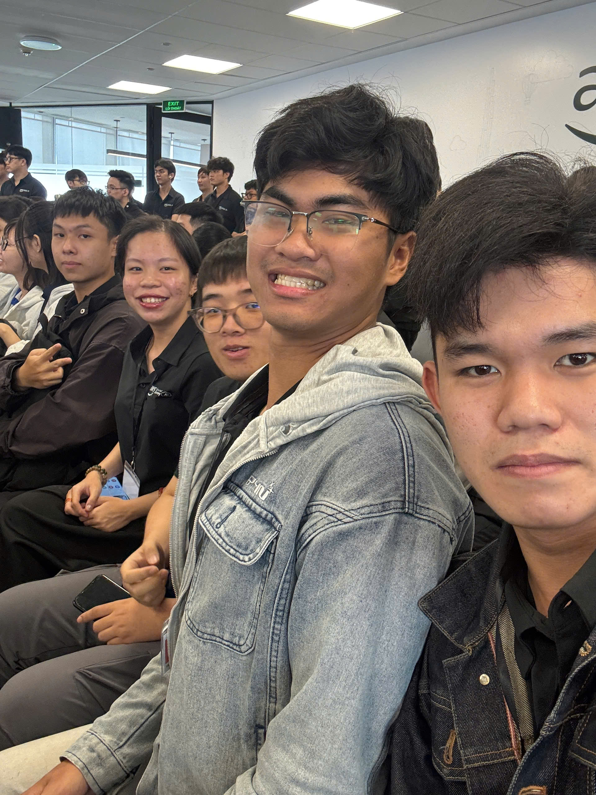

# Saturday Morning at Bitexco: Five Sessions, Three Hours, and Five Lessons to Take Away

On Saturday, November 14, 2026, I attended the _First Cloud AI Journey_ meetup on the 26th floor of Bitexco Financial Tower. The event lasted three hours, from 9:00 AM to 12:00 PM, and featured five consecutive sessions covering Cloud Computing and AI Agents, presented by experienced Tech Leads and engineers working in the industry.

As a student, my main purpose was to gain practical knowledge, listen to industry professionals, and better understand how these technologies are being applied in real projects. The atmosphere was welcoming and comfortable, but whenever a live demonstration or Q&A session started, the room quickly became quiet as attendees focused on the presentations and took notes.

## What I Found Most Interesting

### 1. Building a Vietnamese Voice AI Call Center

The first session introduced how to develop a Vietnamese voice-based call center using AWS. One important point discussed was latency. Even a very short delay in voice responses can make an AI conversation feel unnatural.

The most impressive moment was a live demonstration in which an AI system made an actual phone call and conducted an initial interview for a Cloud Engineer position in Vietnamese. Its ability to communicate naturally showed me that Voice AI is no longer just an experimental concept but is becoming a practical solution for real-world applications.

### 2. Two Important Perspectives on Cloud Security

Two sessions focused on improving infrastructure security.

The first discussed sharing resources across multiple AWS accounts within an AWS Organization. The presentation highlighted the importance of defining clear permission boundaries to ensure that users can only access the resources they are authorized to manage.

The second session introduced the concept of shifting security checks earlier into the development process. This included scanning Infrastructure as Code (IaC) during pull requests and using an adversarial user-persona agent to test staging environments before deployment.

Both sessions reinforced an important principle: identifying security problems early can significantly reduce the effort and cost required to resolve them.

### 3. Bringing AI Agents into Production with Amazon Bedrock AgentCore

Another session explored Amazon Bedrock AgentCore and how AI Agents can be operated in production environments.

I was particularly interested in the discussion about agent memory management. The speaker explained the importance of separating short-term and long-term memory so that an agent can retain useful information about users without keeping unnecessary context.

This helped me understand that building an AI Agent involves more than simply connecting a model to a set of tools. Memory management and reliable execution are also essential parts of the system.

### 4. Kiro Crew and the Closing Q&A

This was my favorite part of the event. The session introduced the idea of running continuous AI Agents to support development activities such as code reviews and system health checks.

The closing Q&A provided several practical insights. The speakers discussed how they manage context windows, monitor token consumption across different components, remove outdated memory to control costs, and establish guardrails to prevent AI systems from accidentally deleting infrastructure or exposing sensitive information.

These discussions helped me see the importance of balancing AI automation with security, cost management, and operational control.

## Five Lessons I Want to Apply After This Meetup

### 1. Greater Agent Autonomy Requires Stronger Security Controls

Throughout the sessions, from IAM permissions to AI guardrails, the speakers repeatedly emphasized considering what could go wrong before focusing on what an AI system can accomplish.

For my personal coding-assistant project, I want to review how credentials are managed, make sure no sensitive information or secrets are stored in the repository, and limit tool permissions to only what the agent actually needs by following the Least Privilege principle.

### 2. Context and Memory Need to Be Managed Carefully

Previously, I often included large amounts of information in AI prompts because I assumed that providing more context would always produce better results.

However, the Q&A helped me realize that unnecessarily large context windows can increase token consumption and sometimes make AI responses less focused.

Going forward, I plan to divide complex tasks into smaller steps, use separate sessions when working on different tasks, and provide only the information relevant to each specific request.

### 3. Security Should Be Part of the Development Process from the Beginning

The discussion about detecting vulnerabilities during code reviews made me reconsider my usual development approach. I often focus on making a project work first and only think about security afterward.

I want to change this habit by checking infrastructure configurations, access permissions, and sensitive information before every deployment, including development and testing environments.

### 4. Learn from Engineers with Real Production Experience

Listening to engineers discuss actual technical challenges helped me recognize the difference between completing classroom assignments and maintaining systems in production.

Instead of only learning concepts theoretically, I plan to choose one topic from the meetup, such as building a lightweight AI Agent with proper logging, and implement a small practical project to understand the process more deeply.

### 5. Become More Active in Technology Communities

I am still somewhat hesitant when it comes to approaching people I have never met. However, this meetup reminded me that participating in a community is much more valuable when I actively communicate and exchange ideas with others.

For future events, I want to challenge myself to ask at least one question during the Q&A session and introduce myself to two new attendees.

## Final Thoughts

I left Bitexco with plenty of new information to think about. More importantly, the event helped me understand an engineering mindset that I had not fully appreciated before: getting an AI system to work is only the first step. Making it secure, cost-efficient, reliable, and manageable is what truly matters.

This week, I plan to start with two practical improvements to my current project: reviewing access permissions and removing any unnecessary secrets, as well as improving the way I organize and manage context when working with AI.

For anyone who is beginning their journey in Cloud Computing or AI, I would recommend attending technology meetups and connecting with people in the industry. Those three hours on a Saturday morning gave me valuable perspectives that would have been difficult to gain through self-study alone.

#### Some event photos

> Overall, the event not only provided technical knowledge but also helped me reshape my thinking about application design, system modernization, and cross-team collaboration.
