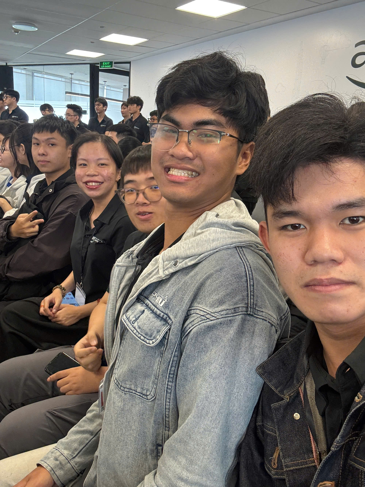

# Một buổi sáng tại Bitexco: 5 phiên chia sẻ, 3 giờ trải nghiệm và 5 bài học đáng nhớ

Vào thứ Bảy, ngày 14/11/2026, tôi có cơ hội tham gia buổi meetup **First Cloud AI Journey** tại tầng 26 của tòa nhà Bitexco Financial Tower. Chương trình kéo dài khoảng 3 tiếng, từ 9:00 đến 12:00, với 5 phiên chia sẻ xoay quanh Cloud Computing và AI Agents, được trình bày bởi các Tech Lead và kỹ sư đang trực tiếp làm việc trong ngành.

Dù thời lượng không quá dài, sự kiện mang đến nhiều góc nhìn thực tế về cách các doanh nghiệp đang ứng dụng AI, triển khai hệ thống trên Cloud và giải quyết những vấn đề kỹ thuật trong môi trường Production.

## 1. Những nội dung nổi bật từ các phiên chia sẻ

### Vietnamese Voice AI trên AWS

Phiên đầu tiên giới thiệu giải pháp Voice AI dành cho tổng đài chăm sóc khách hàng bằng tiếng Việt, được xây dựng trên nền tảng AWS. Một trong những vấn đề đáng chú ý là độ trễ (latency), bởi trong các cuộc hội thoại trực tiếp, chỉ cần phản hồi chậm cũng có thể ảnh hưởng đến trải nghiệm của người dùng.

Phần demo trực tiếp mô phỏng một cuộc gọi bằng tiếng Việt, trong đó AI thực hiện các câu hỏi để sàng lọc ứng viên cho vị trí Cloud Engineer. Đây là ví dụ thực tế cho thấy AI không chỉ xử lý văn bản mà còn có thể tham gia vào những quy trình giao tiếp phức tạp hơn.

### Security: Bảo mật cần được triển khai từ sớm

Hai phiên tiếp theo tập trung vào các khía cạnh bảo mật trong môi trường Cloud.

- **Cross-account resource sharing:** Chia sẻ tài nguyên giữa các tài khoản AWS trong cùng một AWS Organization và quản lý quyền truy cập thông qua Permission Boundaries.
- **Shift-left Security:** Đưa các hoạt động kiểm tra bảo mật lên sớm hơn trong quy trình phát triển, chẳng hạn như quét cấu hình IaC ngay tại Pull Request và sử dụng các AI Agent mô phỏng những User Persona có hành vi đối kháng để kiểm tra môi trường Staging.

Điểm chung của cả hai nội dung là không nên đợi đến khi hệ thống được triển khai mới bắt đầu quan tâm đến bảo mật. Việc phát hiện và xử lý rủi ro càng sớm sẽ giúp giảm thiểu những vấn đề nghiêm trọng về sau.

### Amazon Bedrock AgentCore và quản lý bộ nhớ của AI Agent

Một phiên chia sẻ khác giới thiệu Amazon Bedrock AgentCore, tập trung vào việc xây dựng và vận hành AI Agent trong môi trường Production.

Nội dung khiến tôi quan tâm là cách quản lý bộ nhớ (Memory Management) của Agent, đặc biệt là sự khác biệt giữa Short-term Memory và Long-term Memory. Việc tổ chức và lưu trữ thông tin phù hợp giúp Agent duy trì ngữ cảnh cần thiết mà không phải xử lý quá nhiều dữ liệu không liên quan.

### Kiro Crew: AI Agent hỗ trợ công việc liên tục

Phiên cuối cùng giới thiệu Kiro Crew và cách sử dụng các AI Agent để hỗ trợ những công việc như Code Review, kiểm tra hệ thống và thực hiện các tác vụ lặp lại.

Phần Q&A cũng đề cập đến nhiều vấn đề thực tế khi sử dụng AI Agent, chẳng hạn như Context Window, Token Usage, dữ liệu Memory cũ và chi phí vận hành. Đặc biệt, việc thiết lập Guardrails để ngăn Agent thực hiện những hành động nguy hiểm như xóa Infrastructure hoặc làm rò rỉ dữ liệu là một vấn đề rất đáng quan tâm.

## 2. Năm bài học tôi rút ra sau sự kiện

### 1. AI Agent càng tự chủ thì càng cần nhiều ràng buộc bảo mật

Trao cho AI Agent nhiều quyền thực hiện tác vụ đồng nghĩa với việc phải kiểm soát quyền hạn chặt chẽ hơn. Tôi nhận ra rằng cần thường xuyên kiểm tra Access Keys, tránh lưu Secrets trong Source Code và luôn áp dụng nguyên tắc Least Privilege.

### 2. Context và Memory cần được quản lý hợp lý

Việc cung cấp quá nhiều Context không phải lúc nào cũng giúp AI hoạt động hiệu quả hơn. Điều này còn có thể làm tăng Token Usage và chi phí. Một cách tiếp cận tốt hơn là chia nhỏ nhiệm vụ, bắt đầu Session mới khi cần thiết và chỉ cung cấp những thông tin thực sự liên quan.

### 3. Security nên được tích hợp ngay từ đầu

Thay vì chỉ kiểm tra bảo mật trước khi đưa ứng dụng lên Production, chúng ta nên xem xét cấu hình Infrastructure và quyền truy cập ngay trong quá trình phát triển. Ngay cả những bản Build dùng để thử nghiệm cũng cần được kiểm tra cẩn thận.

### 4. Học hỏi từ những người có kinh nghiệm thực tế

Những chia sẻ từ Tech Lead và các kỹ sư đang làm việc trực tiếp với Cloud và AI giúp tôi hiểu rõ hơn về những vấn đề có thể gặp phải trong môi trường thực tế. Thay vì chỉ tiếp thu kiến thức lý thuyết, tôi muốn chọn một chủ đề cụ thể, chẳng hạn như xây dựng một AI Agent đơn giản có Logging, rồi tự triển khai để hiểu sâu hơn.

### 5. Chủ động kết nối với cộng đồng công nghệ

Một sự kiện công nghệ không chỉ là nơi tiếp nhận kiến thức mà còn là cơ hội để gặp gỡ những người có cùng mối quan tâm. Tôi muốn chủ động hơn trong những lần tham gia tiếp theo bằng cách đặt ít nhất một câu hỏi trong phần Q&A, đồng thời làm quen và trao đổi với hai người tham dự khác.

## 3. Tổng kết

Buổi meetup _First Cloud AI Journey_ giúp tôi có thêm góc nhìn thực tế về sự kết hợp giữa Cloud Computing và AI Agents. Điều tôi ấn tượng nhất là việc xây dựng một AI Agent có thể hoạt động chỉ là bước khởi đầu. Để đưa nó vào Production, chúng ta còn phải giải quyết nhiều vấn đề liên quan đến bảo mật, chi phí, khả năng kiểm soát và độ tin cậy.

Sau sự kiện, tôi muốn bắt đầu từ những việc thiết thực hơn: kiểm tra lại quyền truy cập và Secrets trong các dự án cá nhân, đồng thời cải thiện cách quản lý Context khi sử dụng AI.

Đây là một buổi chia sẻ hữu ích, không chỉ giúp tôi cập nhật thêm kiến thức mà còn nhắc nhở rằng một kỹ sư phần mềm cần quan tâm đến cách hệ thống vận hành trong thực tế, chứ không chỉ dừng lại ở việc làm cho nó hoạt động.

#### Một số hình ảnh khi tham gia sự kiện

> Tổng thể, sự kiện không chỉ cung cấp kiến thức kỹ thuật mà còn giúp tôi thay đổi cách tư duy về thiết kế ứng dụng, hiện đại hóa hệ thống và phối hợp hiệu quả hơn giữa các team.
