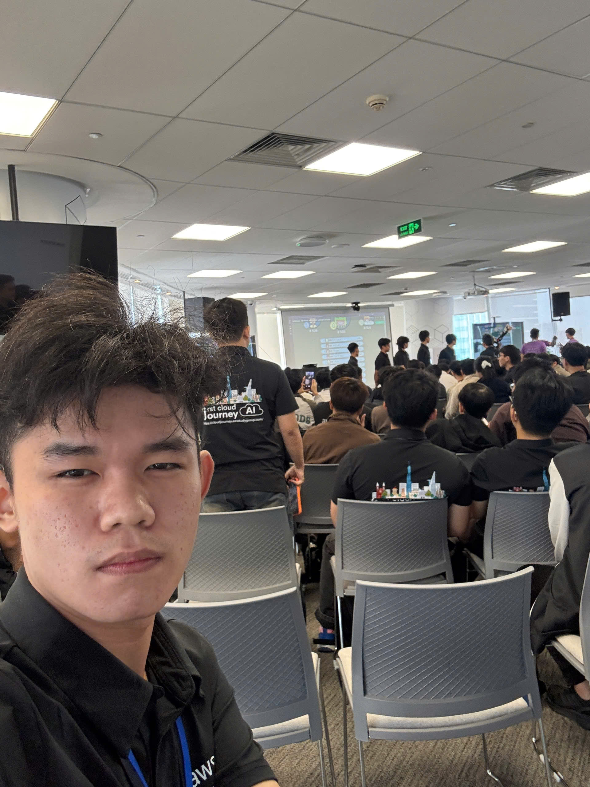

# AWS Student Community Day Vietnam 2026: Connecting Students with Cloud and AI

On Saturday, November 21, 2026, I had the opportunity to take part in **AWS Student Community Day Vietnam 2026**, a technology event dedicated to students who are interested in Cloud Computing and Artificial Intelligence. The event took place from 9:00 AM to 11:30 AM on the 26th floor of Bitexco Financial Tower in Ho Chi Minh City.

Organized by the AWS Student Builder Groups, including AWS Cloud Club, FPTU, NEU, and PTIT, the event brought together students who share an interest in Cloud and AI technologies. It provided an opportunity to learn from experienced speakers, gain practical knowledge, and connect with the local technology community.

## 1. Event Overview

AWS Student Community Day Vietnam 2026 was designed to help students get closer to the real-world applications of Cloud Computing and AI.

Rather than focusing only on theoretical knowledge, the event aimed to create an environment where students could interact with experienced professionals, explore practical technology topics, and exchange ideas with other members of the community.

Some key information about the event:

- **Event:** AWS Student Community Day Vietnam 2026
- **Date:** Saturday, November 21, 2026
- **Time:** 9:00 AM – 11:30 AM
- **Location:** 26th Floor, Bitexco Financial Tower, Ho Chi Minh City
- **Organizers:** AWS Student Builder Groups Vietnam
- **Cost:** Free admission

## 2. Key Highlights

### Learning from Experienced Speakers

One of the main highlights of the event was the opportunity to gain practical knowledge about Cloud Computing and AI from experienced speakers.

For students who are beginning their journey in these fields, learning from people with real-world experience can provide a clearer understanding of how technologies are applied beyond classroom exercises and personal projects.

### Connecting with the Technology Community

The event also created an opportunity to meet other students who are interested in AWS, Cloud Computing, and AI.

Exchanging ideas and experiences with people from different universities can help broaden perspectives, discover new learning resources, and build connections that may be valuable in the future.

### Interactive Activities and Networking

In addition to the knowledge-sharing sessions, participants could take part in Q&A discussions and minigames.

These activities made the event more interactive and encouraged students to communicate, ask questions, and engage with the community. There were also exclusive gifts for participants who actively joined these activities.

## 3. What I Gained from the Event

### 1. A Better Understanding of Cloud and AI

The event reinforced the importance of continuously learning about Cloud Computing and AI, two areas that are increasingly relevant to modern software development.

It also encouraged me to explore how AWS services can be used to solve practical problems rather than learning each service independently.

### 2. Learning Beyond the Classroom

Listening to experienced speakers and interacting with the technology community provided a different perspective compared with studying through online courses or documentation alone.

I realized that practical experience and knowledge sharing are important parts of becoming a better software engineer.

### 3. Expanding My Professional Network

Meeting students from different universities gave me the chance to exchange learning experiences and understand how others approach their Cloud and AI learning journeys.

Building connections within the technology community can also create opportunities for future collaboration and professional development.

### 4. Staying Motivated to Explore AWS

Participating in a community event like this encouraged me to continue developing my AWS knowledge.

I want to apply what I have learned to personal projects, gain more hands-on experience, and gradually build the technical skills needed for a future career in Cloud Computing and DevOps.

## 5. Conclusion

AWS Student Community Day Vietnam 2026 was a valuable opportunity to connect with the student technology community and explore the growing fields of Cloud Computing and AI.

The event reminded me that learning technology is not only about studying documentation or completing technical exercises. It is also about sharing knowledge, learning from experienced people, and actively participating in the community.

Moving forward, I hope to apply the knowledge gained from these experiences to my own projects and continue improving my skills in AWS, Cloud Computing, and DevOps.

#### Some event photos

