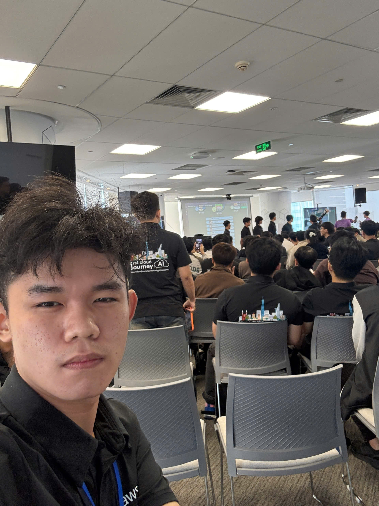

# AWS Student Community Day Vietnam 2026: Kết nối sinh viên với Cloud và AI

Vào thứ Bảy, ngày 21/11/2026, tôi có cơ hội tham gia sự kiện **AWS Student Community Day Vietnam 2026**, một chương trình công nghệ dành cho các bạn sinh viên quan tâm đến lĩnh vực Cloud Computing và Artificial Intelligence. Sự kiện diễn ra từ 9:00 đến 11:30 tại tầng 26, tòa nhà Bitexco Financial Tower, TP. Hồ Chí Minh.

Được tổ chức bởi liên minh các AWS Student Builder Groups, bao gồm AWS Cloud Club, FPTU, NEU và PTIT, sự kiện quy tụ những sinh viên có chung niềm đam mê với công nghệ Cloud và AI. Đây là cơ hội để người tham dự tiếp cận kiến thức thực tiễn từ các diễn giả giàu kinh nghiệm, mở rộng hiểu biết và kết nối với cộng đồng công nghệ.

## 1. Tổng quan về sự kiện

AWS Student Community Day Vietnam 2026 được tổ chức nhằm giúp sinh viên tiếp cận gần hơn với những ứng dụng thực tế của Cloud Computing và AI.

Thay vì chỉ tập trung vào kiến thức lý thuyết, sự kiện hướng đến việc tạo ra một môi trường để sinh viên có thể giao lưu với những người có kinh nghiệm, tìm hiểu các chủ đề công nghệ thực tiễn và trao đổi kiến thức với những thành viên khác trong cộng đồng.

Một số thông tin chính về sự kiện:

- **Tên sự kiện:** AWS Student Community Day Vietnam 2026
- **Thời gian:** 09:00 – 11:30, thứ Bảy, ngày 21/11/2026
- **Địa điểm:** Tầng 26, Bitexco Financial Tower, TP. Hồ Chí Minh
- **Đơn vị tổ chức:** AWS Student Builder Groups Vietnam
- **Chi phí:** Miễn phí tham gia

## 2. Những điểm nổi bật của sự kiện

### Học hỏi kiến thức từ các diễn giả giàu kinh nghiệm

Một trong những điểm đáng chú ý của chương trình là cơ hội tiếp cận những kiến thức thực tiễn về Cloud Computing và AI thông qua các phần chia sẻ từ những diễn giả có kinh nghiệm.

Đối với sinh viên đang bắt đầu tìm hiểu những lĩnh vực này, việc lắng nghe chia sẻ từ những người làm việc trong ngành giúp hình dung rõ hơn cách các công nghệ được ứng dụng trong thực tế, thay vì chỉ tiếp cận thông qua bài tập trên lớp hoặc các dự án cá nhân.

### Kết nối với cộng đồng công nghệ

Sự kiện cũng tạo điều kiện để gặp gỡ và giao lưu với những sinh viên có cùng mối quan tâm đến AWS, Cloud Computing và AI.

Việc trao đổi kiến thức và kinh nghiệm với các bạn đến từ nhiều trường đại học khác nhau giúp mở rộng góc nhìn, khám phá thêm những nguồn tài liệu học tập và xây dựng các mối quan hệ có giá trị cho quá trình phát triển sau này.

### Hoạt động giao lưu và tương tác

Bên cạnh những nội dung chia sẻ kiến thức, người tham gia còn có cơ hội tham gia các hoạt động Q&A và minigame.

Những hoạt động này giúp chương trình trở nên sôi nổi và tương tác hơn, khuyến khích sinh viên chủ động đặt câu hỏi, trao đổi ý kiến và kết nối với cộng đồng. Ngoài ra, người tham gia còn có cơ hội nhận được những phần quà độc quyền khi tích cực tham gia các hoạt động.

## 3. Những giá trị tôi nhận được từ sự kiện

### 1. Hiểu rõ hơn về Cloud và AI

Sự kiện giúp tôi nhận thức rõ hơn về tầm quan trọng của việc liên tục cập nhật kiến thức về Cloud Computing và AI, hai lĩnh vực ngày càng có vai trò quan trọng trong ngành phát triển phần mềm hiện đại.

Đồng thời, chương trình cũng khuyến khích tôi tìm hiểu sâu hơn về cách sử dụng các dịch vụ AWS để giải quyết những vấn đề thực tế, thay vì chỉ học từng dịch vụ một cách riêng lẻ.

### 2. Học hỏi vượt ra ngoài phạm vi lớp học

Việc lắng nghe chia sẻ từ các diễn giả và giao lưu với cộng đồng công nghệ mang đến một góc nhìn khác so với việc tự học thông qua các khóa học trực tuyến hoặc tài liệu kỹ thuật.

Tôi nhận ra rằng kinh nghiệm thực hành và việc chia sẻ kiến thức là những yếu tố quan trọng giúp một kỹ sư phần mềm phát triển tốt hơn.

### 3. Mở rộng mạng lưới quan hệ trong ngành

Gặp gỡ các sinh viên đến từ nhiều trường đại học khác nhau giúp tôi có cơ hội trao đổi kinh nghiệm học tập và tìm hiểu cách những người khác tiếp cận quá trình học Cloud và AI.

Việc xây dựng các mối quan hệ trong cộng đồng công nghệ cũng có thể mở ra những cơ hội hợp tác và phát triển nghề nghiệp trong tương lai.

### 4. Tạo thêm động lực tìm hiểu AWS

Tham gia một sự kiện cộng đồng như thế này giúp tôi có thêm động lực để tiếp tục trau dồi kiến thức về AWS.

Tôi muốn áp dụng những gì đã học vào các dự án cá nhân, tích lũy thêm kinh nghiệm thực hành và từng bước phát triển những kỹ năng kỹ thuật cần thiết cho định hướng nghề nghiệp trong lĩnh vực Cloud Computing và DevOps.

## 5. Tổng kết

AWS Student Community Day Vietnam 2026 là một cơ hội ý nghĩa để tôi kết nối với cộng đồng sinh viên công nghệ và tìm hiểu thêm về hai lĩnh vực đang phát triển mạnh mẽ là Cloud Computing và AI.

Sự kiện giúp tôi nhận ra rằng việc học công nghệ không chỉ dừng lại ở việc đọc tài liệu hay hoàn thành các bài thực hành kỹ thuật. Đó còn là quá trình chia sẻ kiến thức, học hỏi từ những người có kinh nghiệm và chủ động tham gia vào cộng đồng.

Trong thời gian tới, tôi hy vọng có thể vận dụng những kiến thức và kinh nghiệm tích lũy được vào các dự án cá nhân, đồng thời tiếp tục nâng cao kỹ năng về AWS, Cloud Computing và DevOps.

#### Một số hình ảnh khi tham gia sự kiện

